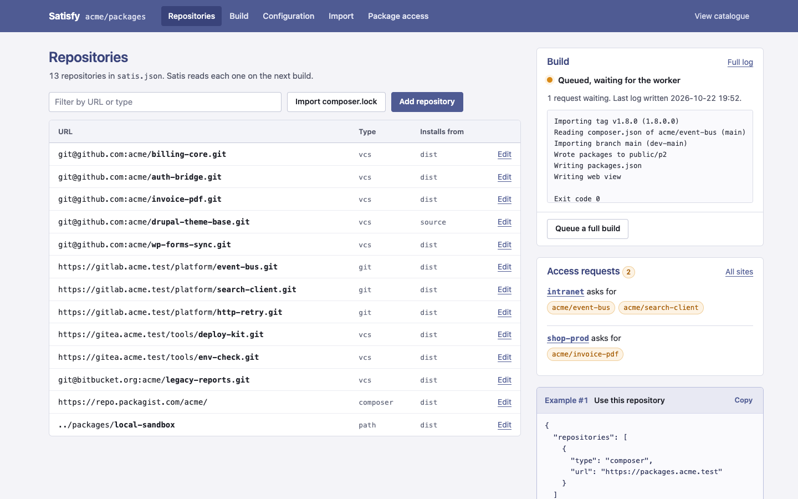
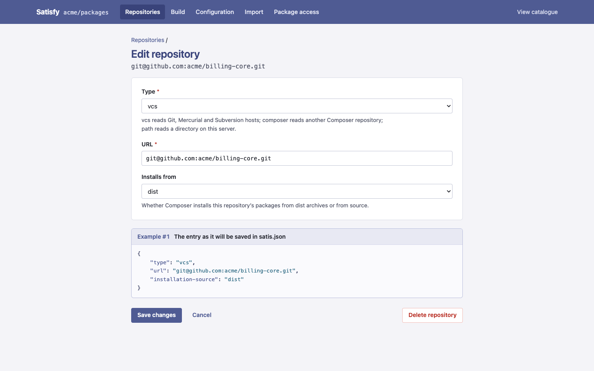
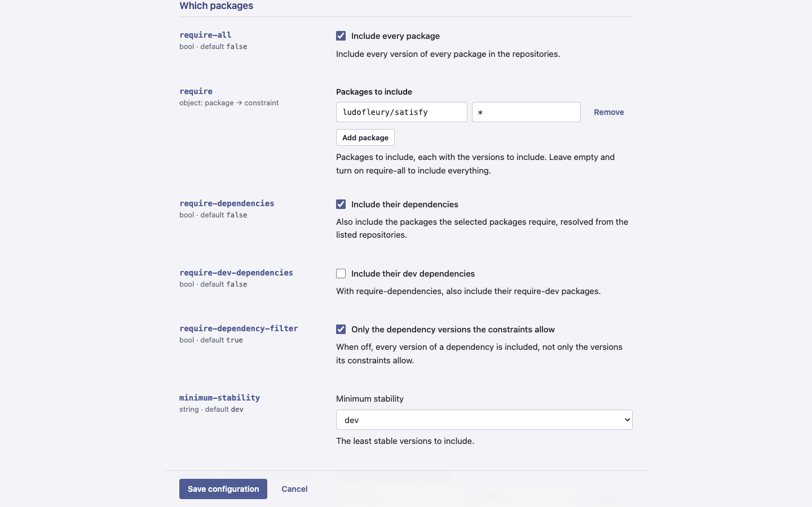
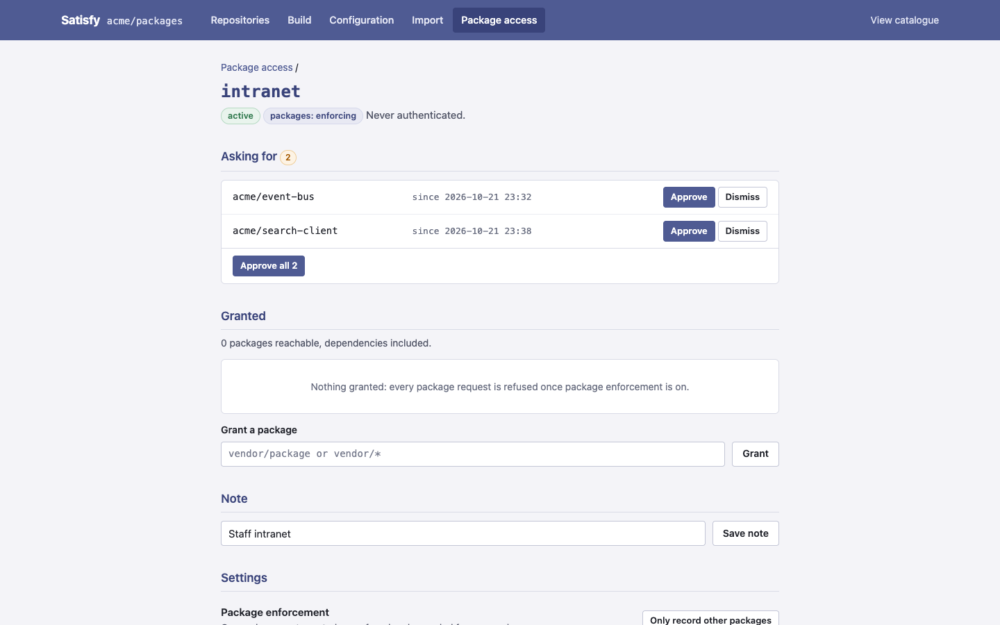
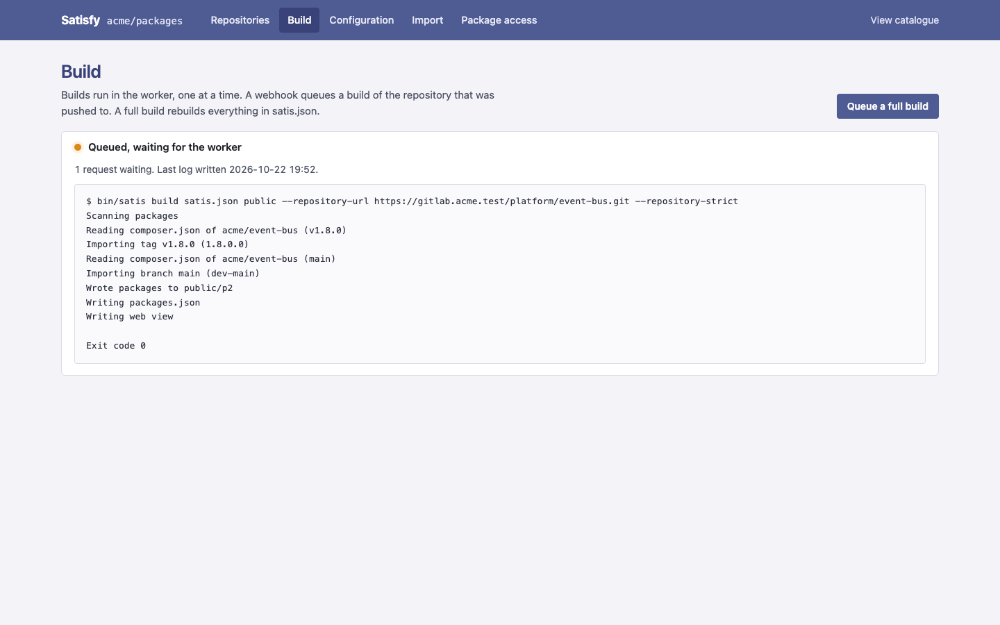

# Satisfy [](https://github.com/project-satisfy/satisfy/actions/workflows/phpunit.yaml)

[Satis Composer repository manager](https://getcomposer.org/doc/articles/handling-private-packages.md) with a web UI.

<p>
  <a href="docs/images/admin.png"></a>
  <a href="docs/images/edit-repository.png"></a>
  <a href="docs/images/configuration.png"></a>
  <a href="docs/images/package-access.png"></a>
</p>

## Introduction

Satisfy provides:

* a web UI over `satis.json`: the repositories, the whole Satis configuration, imports from a `composer.lock`, and builds with their logs
* a login form to restrict the admin UI
* webhook endpoints for GitLab, GitHub, Gitea, Bitbucket and Azure DevOps, which queue a build of the repository pushed to
* a worker that runs the queued builds, so no web request waits for Satis
* Satis itself
* optional plugins, enabled with `SATISFY_PLUGINS`: per-token access to the catalogue with per-package grants (`authz`), and a registration gate and publishing on tag for GitLab system hooks (`hookgate`). See [docs/plugins.md](docs/plugins.md), and each plugin's README: [authz](plugins/Authz/README.md), [hookgate](plugins/Hookgate/README.md)

Satisfy saves you hand-editing `satis.json`. Every change made in the admin UI is written to the file; the repository pages show the entry they write, and the configuration page gives each option's key.

## How it works

Satisfy reads and writes `satis.json`, and runs Satis to build the catalogue from it.

* On each HTTP request, `satis.json` is loaded.
* Every write takes an exclusive lock on the file and writes it in place. When `var/satis/` exists, a copy of the previous version is kept there.
* Webhooks and the admin UI queue builds. The worker, `bin/console satisfy:worker`, runs them one at a time and writes the last build's log to `var/log/build.log`.
* The catalogue (`packages.json`, `p2/`, `include/`, `dist/` and the HTML page) is plain files in the output directory, `public/` by default.

Upgrading from 3.x: see [UPGRADE-4.0.md](UPGRADE-4.0.md). [docs/4.0-architecture.md](docs/4.0-architecture.md) describes the design.

## Installation

### Composer

Satisfy needs PHP 8.4 or later.

* Clone the project: `git clone https://github.com/project-satisfy/satisfy.git`
* Install its dependencies with [Composer](https://getcomposer.org/download/): `composer install -n`. This also writes `config/parameters.yml` from `config/parameters.yml.dist`.

### Satis configuration

* Either define your [default or existing Satis configuration](https://getcomposer.org/doc/articles/handling-private-packages.md)
* or use Satis's interactive command, `./bin/satis init`
* or submit the form at `/admin/configuration`

By default, `satis.json` is expected at the project root. Set `SATIS_CONFIG`, or the `satis_filename` parameter, to use another path.

### Application configuration

* Customize `config/parameters.yml` to your needs. Its values override the defaults in `config/services.yaml`.
* `.env` names the environment variables: paths, the build queue and timeout, the webhook secrets, `TRUSTED_PROXIES` and `SATISFY_PLUGINS`. Override them in `.env.local` or in the environment.

### Security

Restrict the admin UI by setting the `admin.auth` parameter in `config/parameters.yml` to `true`, and list the authorized users in `admin.users`.

## Run Satisfy

Point a web server's document root at `public/`, and run the worker as a service, as the user the web server runs as:

```
bin/console satisfy:worker
```

Or run it from cron with `--once`, which runs whatever is queued and exits. Nothing builds without it. Browse to `/admin` to manage `satis.json`; Composer can read the repository once a build has written `packages.json`.

### Building the catalogue

Queue a full build from the admin UI's Build page, which also shows the last build's log, or build in the calling process:

```
bin/console satisfy:rebuild
```

`satisfy:rebuild` takes the same lock as the worker, so the two never run at once. `./bin/satis build` still runs Satis directly, without that lock.

<a href="docs/images/build.png"></a>

### Automatically build a single package using WebHooks

For example, you can trigger a package generation for your BitBucket project by setting up a BitBucket webhook to connect back to [your-satis-url]/webhook/bitbucket every time you do a code push. This is more efficient than doing a full build and avoids you having to run full builds on a frequent schedule or logging in to the admin interface just to force a build.

A delivery for a repository in `satis.json` queues a build of that repository, and is answered `202 queued`; the worker runs the build.

| Provider | Endpoint | Secret | Checked against |
|---|---|---|---|
| GitLab | `/webhook/gitlab` | `GITLAB_SECRET` | `X-Gitlab-Token` |
| GitHub | `/webhook/github` | `GITHUB_SECRET` | `X-Hub-Signature-256`; JSON or form-encoded |
| Gitea | `/webhook/gitea` | `GITEA_SECRET` | `X-Gitea-Signature` |
| Bitbucket Cloud | `/webhook/bitbucket` | `BITBUCKET_SECRET` | `X-Hub-Signature`; without a secret, Atlassian's published addresses |
| Azure DevOps | `/webhook/devops` | `DEVOPS_SECRET` | An `X-DEVOPS-TOKEN` header added under the service hook's "HTTP headers"; "Resource details to send" must be All |

GitLab, GitHub and Gitea can also add a repository `satis.json` does not list yet: see the `*.auto_add_repo` parameters in `config/services.yaml`. They do so only with the webhook's secret set, since otherwise anyone who can reach the webhook could add a repository of theirs.

## Prebuilt docker image

You can run satisfy using prebuilt docker image. Here is an example how to setup it.

1. Create dir for configuration files
2. Add parameters.yml file, can be copied from config/parameters.yml.dist
3. Add auth.json with all required composer authentication tokens
4. Add simple satis.json with basic information
5. Create docker-compose.yml using example below
6. Start containers `docker compose up`
7. Open `http://localhost:8000/admin`, and queue a full build from the build page, or run `docker compose exec -u www-data satisfy bin/console satisfy:rebuild`
8. Open satis page on `http://localhost:8000`

```
services:
  satisfy:
    image: ghcr.io/project-satisfy/satisfy:latest
    ports:
      - "${APP_PORT:-8000}:80"
    volumes:
      - ./satis.json:/var/www/html/satis.json
      - ./parameters.yml:/var/www/html/config/parameters.yml
      - ./auth.json:/var/www/.composer/auth.json:ro
```

The image runs nginx, which serves the built catalogue as files; php-fpm, which serves the admin UI and the webhooks; and the worker, which runs the builds that the webhooks and the admin UI queue. The first argument picks what runs: `all` (the default), `web`, `worker`, or `rebuild` to build once and exit.

### Running the web server and the worker apart

Only the worker needs Composer's credentials. Run it in a container of its own, and nothing that answers HTTP requests can read them:

```
services:
  web:
    image: ghcr.io/project-satisfy/satisfy:latest
    command: web
    ports:
      - "${APP_PORT:-8000}:80"
    volumes:
      - ./satis.json:/var/www/html/satis.json
      - ./parameters.yml:/var/www/html/config/parameters.yml
      - output:/var/www/html/public
      - queue:/var/www/queue
  worker:
    image: ghcr.io/project-satisfy/satisfy:latest
    command: worker
    volumes:
      - ./satis.json:/var/www/html/satis.json
      - ./parameters.yml:/var/www/html/config/parameters.yml
      - ./auth.json:/var/www/.composer/auth.json:ro
      - output:/var/www/html/public
      - queue:/var/www/queue

volumes:
  output:
  queue:
```

Share the output directory and the queue between the two, and nothing else under `/var/www/html/var`.

### Behind a reverse proxy

Set `TRUSTED_PROXIES` to the proxy's address or range, such as the Docker network's (`172.18.0.0/16`), or to `private_ranges`. Satisfy then builds `https://` URLs when the proxy sends `X-Forwarded-Proto: https`, and its logs give the client's address from `X-Forwarded-For`.

## Authors

* Ludovic Fleury - <ludo.fleury@gmail.com> - <http://twitter.com/ludofleury>
* Julius Beckmann - <satisfy@h4cc.de> - <https://twitter.com/h4cc>
* Ramūnas Dronga - <satisfy@ramuno.lt>

## License

Satisfy is licensed under the MIT License - see the LICENSE file for details

